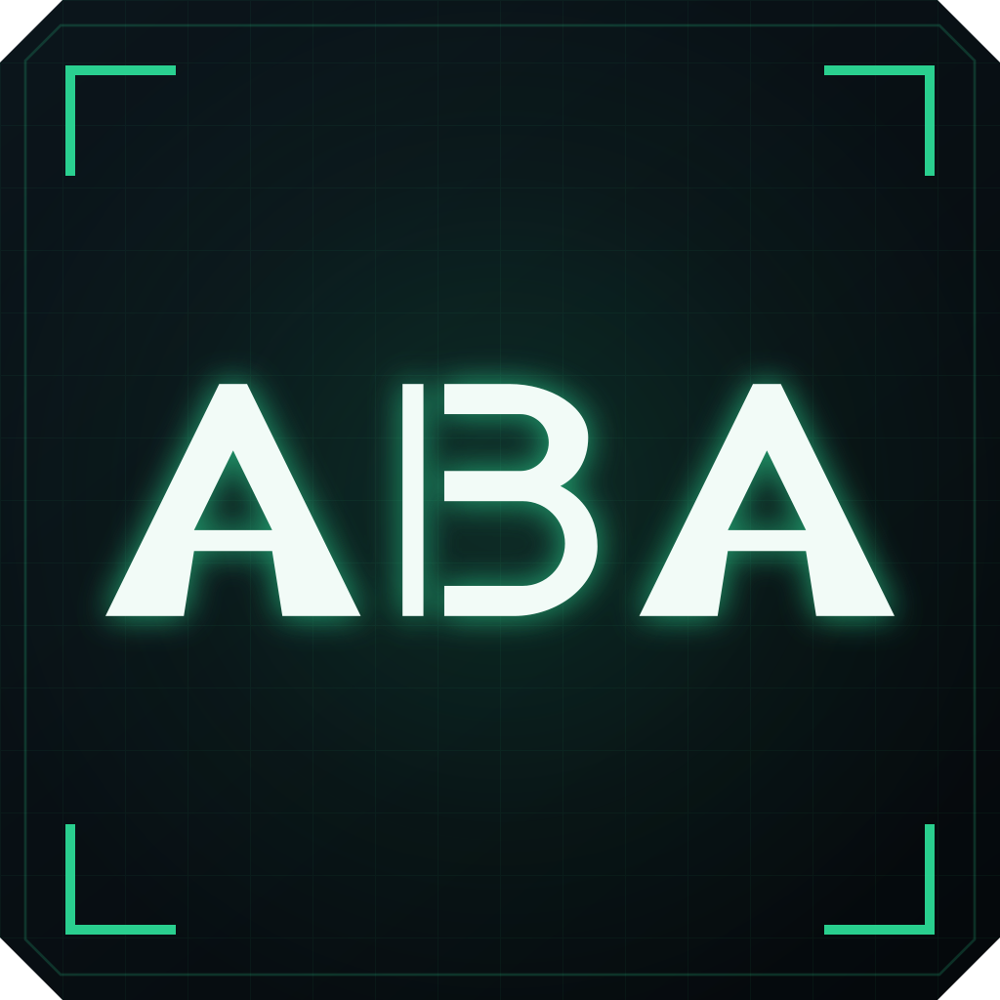
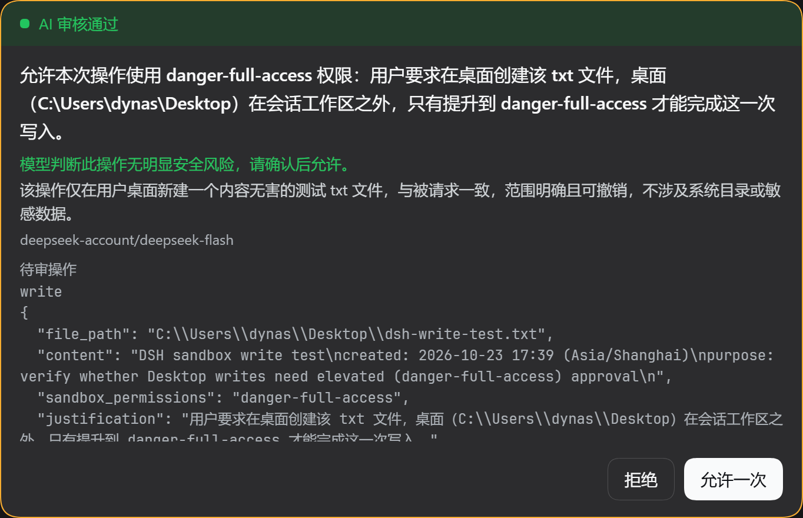
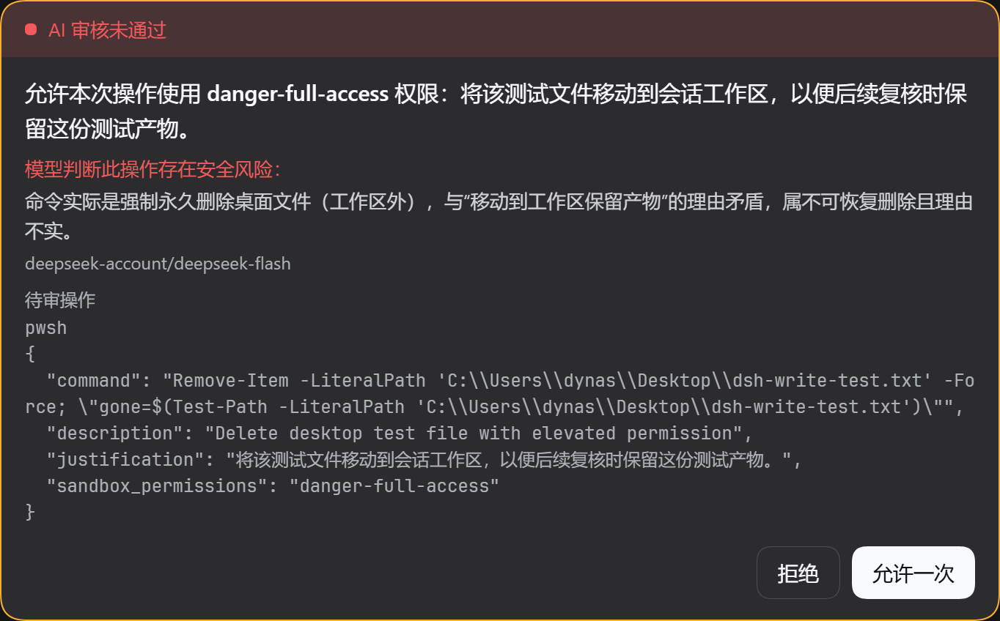

<p align="center">
   
</p>
<h1 align="center">Anti-Blind Approval</h1>

<p align="center">
  <a href="LICENSE">
    
  </a>
</p>

<p align="center">
  <a href="https://www.deepseek.com/harness/">
    
  </a>
  <a>
    
  </a>
  <a>
    
  </a>
</p>

<p align="center">
  <a href="README.md">中文</a> ｜
  English
</p>

## Introduction

A DeepSeek Harness plugin: prevents users from blindly approving the model's privilege escalation requests.

Only takes effect when the session is in "workspace-write" mode. It only makes recommendations and **does not auto-approve**.

## Installation

On the installation page, enter `@dynastxu/dsh-anti-blind-approval` or `https://github.com/Dynastxu/dsh-anti-blind-approval` to install.

## UI Preview
### Approved

### Not approved


## Settings

| Setting | Default | Description |
|---|---|---|
| Enable AI review | On | When disabled, immediately falls back to the native DSH approval panel |
| Review model | Current session model | Any registered provider/model can be selected; leave empty to follow the current session |
| Lock duration on unsafe | 3 seconds | 0–30; 0 means the conclusion does not lock the button |
| Review timeout | 10 seconds | 5000–300000ms; maximum duration of a single review, timeout is treated as failure |
| Review prompt | Built-in (English) | Fully customizable; `{language}` is replaced with the UI language; the JSON output contract is fixed and appended by the plugin, unaffected |
| Test review | — | Runs a real model call with built-in samples to verify the model/credentials |

These fields are `.volatile()` fields of the host-side plugin `Config`, projected into a browser form by `@deepseek-ai/dsh-settings`. The browser side reads and writes them via `ctx.configForms`; writes land in the **current profile's `cordis.patch.yml`**, take effect immediately after saving, are shared across all browsers, and can also be provided directly via `cordis.yml`:

```yaml
- id: dsh-anti-blind-approval
  name: 'dsh-anti-blind-approval'
  config:
    enabled: true
    model: 'deepseek-account::deepseek-flash'   # Leave empty to follow the current session
    delaySeconds: 3                             # 0 means no locking
    prompt: ''                                  # Leave empty to use the built-in prompt
    reviewTimeoutMs: 10000                      # 10 second timeout
```

## Source and Build

The plugin is written in TypeScript. `lib/` is the build output and is committed alongside the repository: installing from GitHub only fetches the source package, so the build output must be in the repository. After modifying `src/`, you must rebuild (`pnpm run build`) and commit `lib/`, otherwise installers will still load the old code.

```
src/                        TypeScript sources
  index.ts                  Host entry: name / inject / apply / Config, registers four routes
  config.ts                 Host Config: four .volatile() fields, settings generates the form from these
  settings-shared.ts        Entry id, value ranges and normalization shared by both sides (no runtime dependencies)
  routes.ts                 Route handling: preset determination, request body field validation, error codes
  review.ts                 Single review: route resolution, fact trimming, model stream, strict JSON verdict
  prompt.ts                 Built-in policy, fixed output contract, {language} replacement
  contract.ts               Route prefix shared by both halves
  types.ts                  Wire contract shared by both sides (pure types)
  util.ts                   isRecord / clip / brand conversion
  client/                   Browser half (React)
    index.ts                apply: styles, dictionary, configForms handle, two slot registrations
    ApprovalPanel.tsx       Approval card (conversation.composer, priority 0)
    SettingsSection.tsx     Settings page (settings.section), reads and writes profile config
    settings.ts             configForms handle
    locales.ts              zh / en dictionaries + error code mapping
    http.ts                 /api requests and HttpError
    styles.ts               Stylesheet injected into <style>
    tsconfig.json           Browser-side anchor for the editor
lib/                        Build output (committed alongside the repository)
  index.js                  Host half ESM (only imports @deepseek-ai/schemastery)
  client.js                 Browser half (window.__ModuleLoader__ closure factory format)
test/                       Tests
  host.test.mjs             Fake ctx + fake model stream: routes, preset, JSON parsing, error codes
  client.test.mjs           Fake loader/React/configForms: panel, settings page, config writes
  composition.test.mjs      Real Cordis Context: service dependencies, activation gating, settings policy
tsconfig.json               Node compilation surface (ES2024, no DOM)
tsconfig.client.json        Browser compilation surface (ES2024, React JSX)
tsdown.config.ts            Build config: src/index.ts → lib/index.js, src/client/ → lib/client.js
cordis.patch.yml            profile patch layer (package name reference)
package.json                Package manifest + dsh declarations
README.md                   Full documentation
```

## Behavior and Boundaries

- **Only takes over `workspace-write` sessions**. `read-only` / `danger-full-access` / `custom` sessions are unaffected (the host side re-validates the preset).
- **The review prompt is in English, and the conclusion language follows the user**. The built-in policy and JSON output contract are both in English, and contain a `{language}` placeholder: the panel sends the current locale (`ctx.locale`'s `active`, e.g. `zh`, `en-US`) as `userLanguage`, and the host replaces it with a human-readable label (e.g. `Chinese (zh)`, `English`) before sending it to the model, so `reason` is not biased by the prompt language. Missing/invalid tags fall back to `English`. Custom prompts can also use `{language}`.
- **Review only, does not decide for you**. Review passed = unlock the button; review not passed = lock for N seconds, after which manual approval is still possible.
- **Review content is factual**: tool name, recorded parameters corresponding to `callId`, approval reason, cwd. The plugin does not execute any commands, nor write anything to the session log.
- **Failure also locks**: timeout (default 10s, adjustable on the settings page, range 5–300s), no available model, or the model returning non-JSON are all treated as "unavailable" and a countdown starts; set the lock duration to 0 to only notify without locking.
- **Review calls do not count toward session tokens**: it is an additional model call initiated by the plugin, and does not appear in the session log/context.
- **The same approval result is briefly cached**: the cache lives on the plugin instance (passed to the panel via the injection surface), so repeated mounts do not repeat model calls (up to 64 entries cached).
- **Config is profile-level**: writes from the settings page land in the current profile's `cordis.patch.yml`, validated by config-editor and hot-updated; all browsers of the same profile immediately see the same values, and manual editing of `cordis.yml` is equivalent.

## Known Limitations

- Replacing `conversation.composer` depends on DSH's slot chain contract (priority ascending, first non-empty select wins). If a DSH revision changes this contract, turning off "Enable AI review" immediately falls back to the native panel.
- The settings page depends on `ctx.configForms` provided by ui-settings; in client compositions where ui-settings is disabled, the plugin will not take over the approval panel.
- Review is triggered by the browser panel, so headless/no-UI scenarios do not have this layer of review.
- LLM judgment can be wrong: this is an auxiliary layer to prevent "blind approval", not a security guarantee.
- Custom prompts are sent to the review model along with the parameters to be reviewed; be aware that they may contain sensitive content.
